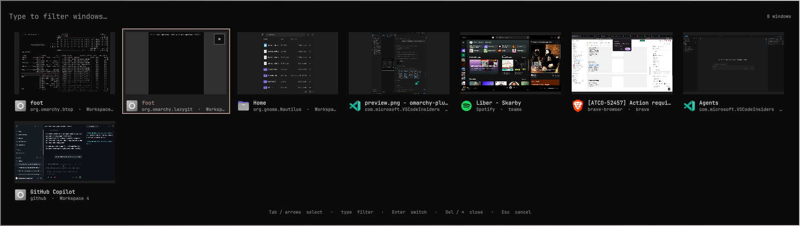

# Window Switcher for Omarchy

An [Omarchy](https://omarchy.org/) plugin that adds a Windows-style
**Alt+Tab switcher** with live previews and filtering, plus
**minimize** (Hyprland has none) with the minimized windows shown in the bar.




## Features

- **Alt+Tab**: hold `Alt`, press `Tab` to move forward (`Shift+Tab` backward),
  release `Alt` to switch. A quick tap jumps to the previous window without
  showing anything. Windows are listed most recently used first.
- **Live previews** of every window, including those on other workspaces and
  special workspaces.
- **Filter**: while the switcher is open, type to filter by title, app class or
  workspace. Typing keeps the switcher open; confirm with `Enter`.
- **Close from the preview**: the selected or hovered window shows a `✕`
  button; click it (or press `Delete`) to close that window and keep switching.
- **Minimize**: `Super+Page Down` parks the focused window on the hidden
  `special:minimized` workspace. `Super+Page Up` restores the last one.
- **Focus mode**: `Super+Home` minimizes every other window on the focused
  window's workspace, leaving only the focused one. Bring them back from the
  bar widget, the switcher, or `Super+Page Up` (one at a time).
- **Bar widget** (`Minimized windows`): one icon per minimized window. Left
  click restores it, middle click closes it. Hidden when nothing is minimized.
  Minimized windows also appear in the switcher (dimmed) and are restored when
  selected.

### Keyboard (switcher open)

| Key                          | Result                          |
| ---------------------------- | ------------------------------- |
| `Tab` / `→`, `Shift+Tab` / `←` | Next / previous window        |
| `↑` / `↓`                    | Previous / next row             |
| any character, `Backspace`   | Edit the filter                 |
| `Enter`, click               | Switch to the selected window   |
| `Delete`, click `✕`          | Close the selected window       |
| `Esc`                        | Clear filter, then close        |

## Requirements

- Omarchy with the shell plugin system and Hyprland with Lua config
- Window previews need Hyprland's toplevel export (default in Hyprland)

## Install

```bash
omarchy plugin add https://github.com/jakubkozera/omarchy-window-switcher.git --enable
```

The plugin runs unsandboxed inside `omarchy-shell`; read the code before
enabling it. Enabling places the `Minimized windows` widget in the bar
(`omarchy bar move jakubkozera.window-switcher --section right` to move it).
Keep it on the bar: the switcher is enabled together with it.

Then add the bindings to `~/.config/hypr/bindings.lua`:

```lua
local switcher = "omarchy-shell -q shell"
local switcher_id = "jakubkozera.window-switcher"
local switcher_held = false

local function switch_window(dir)
  return function()
    switcher_held = true
    hl.exec_cmd(switcher .. " summon " .. switcher_id .. " '{\"dir\":" .. dir .. "}'")
  end
end

-- Alt release commits the choice, even before the overlay has keyboard focus.
local function alt_released()
  if not switcher_held then return end
  switcher_held = false
  hl.exec_cmd(switcher .. " call " .. switcher_id .. " altReleased x")
end

-- Replaces Omarchy's default Alt+Tab ("Focus on next window").
hl.unbind("ALT + TAB")
hl.unbind("ALT + SHIFT + TAB")
o.bind("ALT + TAB", "Window switcher", switch_window(1))
o.bind("ALT + SHIFT + TAB", "Window switcher (reverse)", switch_window(-1))
hl.bind("Alt_L", alt_released, { release = true, non_consuming = true })
hl.bind("Alt_R", alt_released, { release = true, non_consuming = true })

o.bind("SUPER + Page_Down", "Minimize window", hl.dsp.window.move({ workspace = "special:minimized", follow = false }))
o.bind("SUPER + Page_Up", "Restore last minimized window", switcher .. " call " .. switcher_id .. " restoreLast x")

-- Focus mode: minimize every other window on the focused window's workspace.
local function minimize_others()
  local active = hl.get_active_window()
  if not active or not active.workspace then return end
  for _, win in ipairs(hl.get_workspace_windows(active.workspace)) do
    if win.address ~= active.address then
      hl.dispatch(hl.dsp.window.move({ workspace = "special:minimized", follow = false, window = "address:" .. win.address }))
    end
  end
end
o.bind("SUPER + Home", "Minimize other windows on workspace", minimize_others)
```

Validate with `hyprctl reload` and `hyprctl configerrors`.

To open the switcher as a plain picker (stays open until you choose), bind
`omarchy-shell shell summon jakubkozera.window-switcher '{"picker":true}'`.

## Notes

- Minimizing moves the window to `special:minimized`; do not toggle that
  workspace manually.
- The overlay is `keepLoaded`, so changes to its code apply after
  `omarchy restart shell`.

## License

MIT
